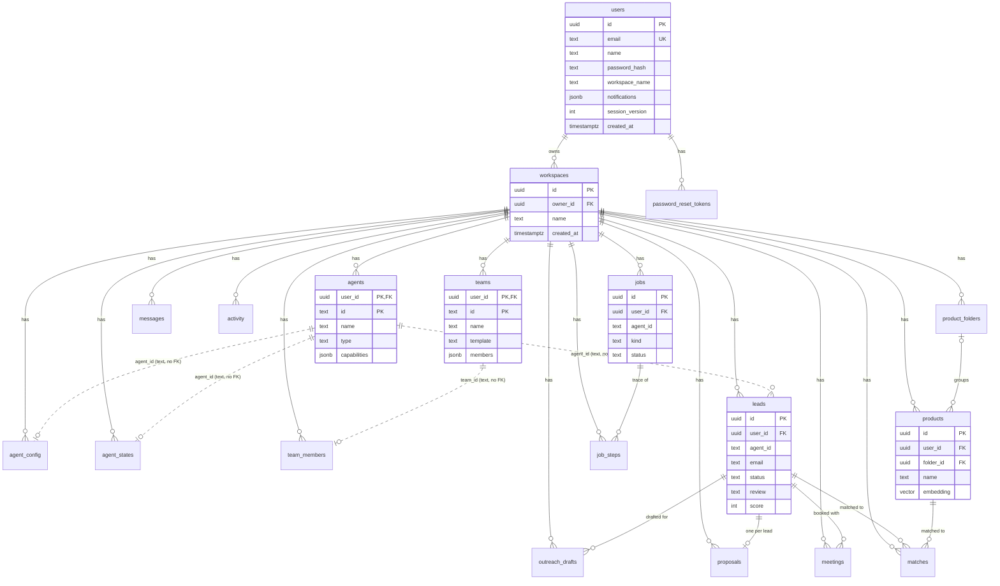

# ERD: Agentic Sales Team

| | |
|---|---|
| **Status** | Build spec, matches `origin/main` at PR #163 (commit `d3c6ff6`) |
| **Last updated** | 2026-11-17 |
| **Source of truth** | `lib/db/schema.ts` and `lib/db/migrations/0000` to `0026` |

The database is one Neon Postgres database with the `pgvector` extension. There are **19 tables**. Rebuild them with the exact names, types and defaults below. Code in the app reads these column names directly, and the test suite checks some of them.

---

## 1. The big rule: `user_id` holds a workspace id

Every data table has a column called `user_id`. **It holds a `workspaces.id`, not a `users.id`.** The column kept its old name when workspaces were added (migration `0025`).

- An account's **first** workspace has the **same id as the account**. Migration `0025` inserts one workspace for each user with `id = users.id`. Because of this, data from before workspaces needed no move.
- Every later workspace gets a new random UUID.
- The only tables that point at `users` are `workspaces`, `password_reset_tokens` and (by key text only) `auth_rate_limits`.

```
users 1 ──< workspaces 1 ──< (every data table, through user_id)
```

When you rebuild, you can call the column `workspace_id` if you start from zero, but then every query in this spec changes name. **To build the exact same thing, keep `user_id`.**

---

## 2. Diagram

GitHub and most Markdown viewers render this Mermaid block.



Dotted lines are **logical links with no foreign key**. `agent_id` and `team_id` are text codes, and team members live in a JSON array. The app checks these links in code.

---

## 3. Tables

Types are Postgres types. `now()` means `DEFAULT now()`. `ws` means `REFERENCES workspaces(id) ON DELETE CASCADE`. All timestamps are `timestamp with time zone`.

### 3.1 Accounts and access

#### `users`
| Column | Type | Null | Default | Notes |
|---|---|---|---|---|
| `id` | uuid | no | `gen_random_uuid()` | PK. Also the id of the first workspace |
| `email` | text | no | | UNIQUE. Stored lower-case |
| `name` | text | no | | |
| `password_hash` | text | no | | bcrypt |
| `workspace_name` | text | no | `'My Workspace'` | Legacy. Copied into `workspaces.name` by `0025` |
| `notifications` | jsonb `Record<string, boolean>` | no | `{}` | Toggles. Hidden in the UI because the app sends no email |
| `session_version` | integer | no | `0` | Put into every session token. Log out and password reset add 1, which revokes all old sessions |
| `created_at` | timestamptz | no | `now()` | |

#### `workspaces`
| Column | Type | Null | Default | Notes |
|---|---|---|---|---|
| `id` | uuid | no | `gen_random_uuid()` | PK |
| `owner_id` | uuid | no | | FK `users.id` ON DELETE CASCADE. Index `workspaces_owner_id_idx` |
| `name` | text | no | | The business name |
| `created_at` | timestamptz | no | `now()` | |

#### `password_reset_tokens`
| Column | Type | Null | Default | Notes |
|---|---|---|---|---|
| `token` | text | no | | PK. A SHA-256 hash of the token, not the token |
| `user_id` | uuid | no | | FK `users.id` ON DELETE CASCADE |
| `expires_at` | timestamptz | no | | Meant to be 1 hour after creation. **Nothing creates tokens today** (self-serve reset is off) |
| `created_at` | timestamptz | no | `now()` | |

#### `auth_rate_limits`
| Column | Type | Null | Default | Notes |
|---|---|---|---|---|
| `key` | text | no | | PK. Format `<action>:<ip\|email>:<value>`. Emails are stored as a SHA-256 hash |
| `count` | integer | no | `0` | |
| `window_start` | timestamptz | no | `now()` | Fixed window |

### 3.2 Agents and teams

#### `agents`
Agents the user created in the wizard.

| Column | Type | Null | Default | Notes |
|---|---|---|---|---|
| `user_id` | uuid | no | | PK part, `ws` |
| `id` | text | no | | PK part. `"x" + Date.now().toString(36) + 3 random base-36 chars` |
| `name` | text | no | | |
| `initials` | text | no | | |
| `role` | text | no | | |
| `color` | text | no | | Always `#006AFF` (no picker) |
| `status` | text | no | | Written once as `'idle'`. The UI derives the live status from jobs |
| `task` | text | no | | Written once as `'Ready for work'` |
| `score` | integer | no | | Written once as `0`. Not shown |
| `goal` | text | no | | Only the first sentence of the wizard text (split on `.`) |
| `char` | integer | yes | | Appearance: 0 Theo, 1 Pat, 2 Maya, 3 Sam. Null = hash of the id mod 4 |
| `type` | text | no | `'custom'` | Agent type preset id |
| `capabilities` | jsonb `string[]` | no | `[]` | Capability ids |
| `created_at` | timestamptz | no | `now()` | |

PK: (`user_id`, `id`).

#### `agent_config`
Edits to an agent. Only edited fields are stored. They win over the base values on load.

| Column | Type | Null | Notes |
|---|---|---|---|
| `user_id` | uuid | no | PK part, `ws` |
| `agent_id` | text | no | PK part |
| `role` | text | yes | |
| `goal` | text | yes | |
| `permissions` | jsonb `Record<string, boolean>` | yes | Loaded and saved, but **no code reads it**. Keep the column; do not use it for approvals |
| `settings` | jsonb `Record<string, Record<string, unknown>>` | yes | Settings for each capability. **Ask/Auto lives here** as `settings[cap].mode` (`"auto"` or `"ask"`, missing = ask). See below |

`settings` shape:

```ts
{
  [capabilityId]: { mode?: "auto" | "ask" },
  "book-meeting": {
    mode?, type?: string,        // default "Meeting"
    duration?: number,           // minutes, default 30
    windowStart?: number,        // hour 0-23, default 9
    windowEnd?: number,          // hour, default 17
    weekdaysOnly?: boolean,      // default true; only an explicit false turns it off
    length?: string              // the raw wizard text
  }
}
```

#### `agent_states`
| Column | Type | Null | Default | Notes |
|---|---|---|---|---|
| `user_id` | uuid | no | | PK part, `ws` |
| `agent_id` | text | no | | PK part |
| `removed` | boolean | no | `false` | Soft delete |
| `paused` | boolean | no | `false` | A paused agent gets no work |

#### `teams`
| Column | Type | Null | Default | Notes |
|---|---|---|---|---|
| `user_id` | uuid | no | | PK part, `ws` |
| `id` | text | no | | PK part. `"tx" + Date.now().toString(36) + 3 random chars` |
| `name` | text | no | | |
| `icon` | text | no | | One of 🚀 🌎 🏛 📣 🎯 💎 |
| `icon_bg` | text | no | | Tint keyed by icon |
| `description` | text | no | | |
| `goal` | text | no | | Shared goal. The Assessor and the Scout read it |
| `members` | jsonb `string[]` | no | `[]` | Agent ids |
| `activity` | jsonb `string[]` | no | `[]` | |
| `meetings` | integer | no | `0` | Legacy counter. The UI computes real numbers |
| `pipeline` | text | no | `'-'` | Legacy. Migration `0023` changed the default from an em dash |
| `leads` | integer | no | `0` | Legacy counter |
| `template` | text | no | `'custom'` | Team template id |
| `created_at` | timestamptz | no | `now()` | |

PK: (`user_id`, `id`).

#### `team_members`
A member list that replaces `teams.members` when present.

| Column | Type | Null | Default |
|---|---|---|---|
| `user_id` | uuid | no | PK part, `ws` |
| `team_id` | text | no | PK part |
| `members` | jsonb `string[]` | no | `[]` |

### 3.3 Chat

#### `messages`
| Column | Type | Null | Default | Notes |
|---|---|---|---|---|
| `id` | serial | no | | PK. Keeps the order inside a thread |
| `user_id` | uuid | no | | `ws` |
| `agent_id` | text | no | | **The thread key. For a team chat it holds the team id** |
| `who` | text | no | | `'me'` (the user), `'system'`, or the id of the agent that speaks |
| `text` | text | no | | The message, with hidden `⟦kind:payload⟧` markers (see below) |
| `created_at` | timestamptz | no | `now()` | |

The `serial id` is the only order and also the poll cursor (`listTeamMessages(teamId, afterId)`).

**There are no JSON columns for cards.** Every interactive part of a message is a hidden marker inside `text`. The client strips the markers before it shows the text and draws the card from them:

| Marker | Draws |
|---|---|
| `⟦approve:<jobId>⟧` | Proceed / Cancel buttons for a `needs_approval` job |
| `⟦scrape:<urlencoded JSON brief>⟧` | The search questions card |
| `⟦answer:<json>⟧` | The user's answer from that card |
| `⟦run:<jobId>⟧` | The live timeline of a job |
| `⟦leads:<id,id>⟧` | The new leads card |
| `⟦meet:<ids>\|<yyyy-mm-dd>⟧` | A waiting "when?" / "what time?" meeting question |
| `⟦meetpick:<json>⟧` / `⟦meetanswer:<json>⟧` | The meeting lead picker and its answer |
| `⟦writepick:<json>⟧` / `⟦writeanswer:<json>⟧` | The outreach lead picker and its answer |
| `⟦replies:<json string[]>⟧` | Quick-reply buttons (at most 6, each at most 80 chars) |
| `⟦job:<jobId>⟧` | Makes a job-result post idempotent (posted once) |

A lead name in `«Name»` shows as a pill.

### 3.4 Leads and the work on them

#### `leads`
| Column | Type | Null | Default | Notes |
|---|---|---|---|---|
| `id` | uuid | no | `gen_random_uuid()` | PK |
| `user_id` | uuid | no | | `ws` |
| `agent_id` | text | no | | The agent that owns the lead. Team leads = leads of the team's members |
| `name` | text | no | | |
| `title` | text | no | `''` | |
| `company` | text | no | `''` | |
| `email` | text | no | | Can be `''` for scraped leads |
| `status` | text | no | `'new'` | Stage: `new` \| `contacted` \| `engaged` \| `replied` \| `meeting` |
| `score` | integer | no | `0` | 0 to 100. Assess, qualify and outreach write it |
| `source` | text | no | `'manual'` | `manual` \| `import` (CSV) \| `scrape` |
| `review` | text | no | `'accepted'` | `pending` \| `accepted` \| `dismissed`. Manual and CSV leads start `accepted`, scraped leads start `pending` |
| `profile_url` | text | yes | | http(s) only |
| `platform` | text | yes | | Taken from the URL: `Facebook`, `Reddit`, `LinkedIn`, `X` or `web` |
| `research` | jsonb `{summary, priorities[], hooks[], angle}` | yes | | Written by research |
| `fit_reason` | text | no | `''` | One line on why it fits. The scraper writes it, the Assessor replaces it |
| `qualified_at` | timestamptz | yes | | Set by qualify. The queue picks leads where this is null |
| `matched_at` | timestamptz | yes | | Set when the Matchmaker ran, fit or not |
| `created_at` | timestamptz | no | `now()` | |
| `updated_at` | timestamptz | no | `now()` | |

#### `outreach_drafts`
| Column | Type | Null | Default | Notes |
|---|---|---|---|---|
| `id` | uuid | no | `gen_random_uuid()` | PK |
| `user_id` | uuid | no | | `ws` |
| `agent_id` | text | no | | |
| `lead_id` | uuid | no | | FK `leads.id` ON DELETE CASCADE |
| `subject` | text | no | | |
| `body` | text | no | | |
| `rationale` | text | no | `''` | Shown as "Why this angle" |
| `status` | text | no | `'draft'` | `draft` \| `sent` |
| `dismissed` | boolean | no | `false` | Soft hide (Discard, Clear sent). Counts still include the row |
| `created_at` | timestamptz | no | `now()` | |
| `sent_at` | timestamptz | yes | | Set by Mark sent |

Index: **`outreach_drafts_live_lead_idx`**, UNIQUE on `lead_id` WHERE `status <> 'sent' AND dismissed = false`. At most one live draft per lead.

#### `proposals`
| Column | Type | Null | Default | Notes |
|---|---|---|---|---|
| `id` | uuid | no | `gen_random_uuid()` | PK |
| `user_id` | uuid | no | | `ws` |
| `agent_id` | text | no | | |
| `lead_id` | uuid | no | | FK `leads.id` ON DELETE CASCADE |
| `title` | text | no | | |
| `body` | text | no | | |
| `products` | jsonb `string[]` | no | `[]` | Names of the products the proposal uses |
| `status` | text | no | `'draft'` | `draft` \| `sent` |
| `created_at` | timestamptz | no | `now()` | |
| `sent_at` | timestamptz | yes | | |

Index: **`proposals_lead_id_idx`**, UNIQUE on `lead_id`. One proposal per lead.

#### `matches`
| Column | Type | Null | Default | Notes |
|---|---|---|---|---|
| `id` | uuid | no | `gen_random_uuid()` | PK |
| `user_id` | uuid | no | | `ws` |
| `agent_id` | text | no | | |
| `lead_id` | uuid | no | | FK `leads.id` ON DELETE CASCADE |
| `product_id` | uuid | no | | FK `products.id` ON DELETE CASCADE |
| `score` | integer | no | `0` | 0 to 100 fit |
| `reason` | text | no | `''` | |
| `created_at` | timestamptz | no | `now()` | |

#### `meetings`
The only source for the calendar.

| Column | Type | Null | Default | Notes |
|---|---|---|---|---|
| `id` | uuid | no | `gen_random_uuid()` | PK |
| `user_id` | uuid | no | | `ws` |
| `agent_id` | text | no | | |
| `lead_id` | uuid | no | | FK `leads.id` ON DELETE CASCADE |
| `title` | text | no | `'Meeting'` | |
| `when_at` | timestamptz | no | | |
| `when_label` | text | no | `''` | For example `Tue, Jul 15 · 2:00–2:30 PM`, in the user's time zone |
| `created_at` | timestamptz | no | `now()` | |

### 3.5 Catalog

#### `product_folders`
| Column | Type | Null | Default |
|---|---|---|---|
| `id` | uuid | no | `gen_random_uuid()` (PK) |
| `user_id` | uuid | no | `ws` |
| `name` | text | no | |
| `created_at` | timestamptz | no | `now()` |

#### `products`
| Column | Type | Null | Default | Notes |
|---|---|---|---|---|
| `id` | uuid | no | `gen_random_uuid()` | PK |
| `user_id` | uuid | no | | `ws` |
| `folder_id` | uuid | yes | | FK `product_folders.id` ON DELETE SET NULL. Null = Unfiled |
| `name` | text | no | | |
| `description` | text | no | `''` | |
| `price` | text | no | `''` | Free text, not a number |
| `category` | text | no | `''` | |
| `attributes` | jsonb `Record<string,string>` | no | `{}` | Any extra CSV column |
| `embedding` | vector(768) | yes | | Gemini `gemini-embedding-001` |
| `created_at` | timestamptz | no | `now()` | |

Index: **`products_embedding_idx`** USING `hnsw (embedding vector_cosine_ops)`. This index is only in raw migration `0012`. Drizzle does not manage vector indexes, so write it by hand.

### 3.6 Work queue and log

#### `jobs`
| Column | Type | Null | Default | Notes |
|---|---|---|---|---|
| `id` | uuid | no | `gen_random_uuid()` | PK |
| `user_id` | uuid | no | | `ws` |
| `agent_id` | text | no | | |
| `kind` | text | no | | `scrape`, `assess`, `research`, `qualify`, `match`, `outreach`, `proposal`, `book-meeting` |
| `status` | text | no | `'queued'` | `needs_approval` (waits for Proceed) \| `queued` \| `running` \| `done` \| `failed` \| `dismissed` (cancelled). **A pending approval is a job row with `needs_approval`; there is no approvals table** |
| `params` | jsonb | no | `{}` | `{agent:{id,name,role,goal,task}, leadIds, batchSize, target, instruction, pod, teamId, leadCount}` |
| `result` | jsonb | yes | | Counts for the kind (for example `{leadsFound, leadIds}`, `{draftsCreated, failed}`, `{assessed, accepted, dismissed}`, `{booked}`) **plus `steps`, the live timeline** (see `01-prd.md` §7.3) |
| `error` | text | yes | | |
| `created_at` | timestamptz | no | `now()` | |
| `started_at` | timestamptz | yes | | |
| `finished_at` | timestamptz | yes | | |

#### `job_steps`

> **Unused.** Left from an earlier browser-based scraper. No code reads or writes it. Create it so the schema matches, but do not build on it. The live timeline is in `jobs.result.steps`.

| Column | Type | Null | Default | Notes |
|---|---|---|---|---|
| `id` | uuid | no | `gen_random_uuid()` | PK |
| `job_id` | uuid | no | | FK `jobs.id` ON DELETE CASCADE |
| `user_id` | uuid | no | | `ws` |
| `idx` | integer | no | | Order in the run |
| `caption` | text | no | `''` | |
| `url` | text | no | `''` | |
| `screenshot_path` | text | no | `''` | From an earlier browser-based scraper. Kept for the schema |
| `created_at` | timestamptz | no | `now()` | |

#### `activity`
The real event log. Feeds the notifications bell, the dashboard and the team page.

| Column | Type | Null | Default | Notes |
|---|---|---|---|---|
| `id` | uuid | no | `gen_random_uuid()` | PK |
| `user_id` | uuid | no | | `ws` |
| `agent_id` | text | no | | |
| `type` | text | no | | `lead_added`, `lead_assessed`, `lead_researched`, `lead_qualified`, `email_drafted`, `email_sent`. Match, proposal and meeting write no activity |
| `lead_id` | uuid | yes | | No FK |
| `text` | text | no | | |
| `dismissed` | boolean | no | `false` | Cleared from the bell only. Counts still read every row |
| `created_at` | timestamptz | no | `now()` | |

---

## 4. Rules the data follows

| Rule | Where it is enforced |
|---|---|
| Every query filters on `user_id = <active workspace id>` | Server code (`lib/workspaces/scope.ts`). There is no Postgres row-level security |
| Deleting a workspace deletes all its data | `ON DELETE CASCADE` from every `user_id` |
| Deleting a lead deletes its drafts, proposal, matches and meetings | `ON DELETE CASCADE` on `lead_id` |
| Deleting a folder leaves its products as Unfiled | `ON DELETE SET NULL` on `folder_id` |
| One live draft per lead, one proposal per lead | Partial unique index, unique index (migration `0026`) |
| "Delete" for drafts and notifications is a soft hide | `dismissed = true`. Counts never go down |
| Deleting an agent is a soft delete | `agent_states.removed = true` |
| Multi-step writes run in one transaction | Server code, `db.transaction` |

---

## 5. Migrations

- Generate SQL with `drizzle-kit generate` from `lib/db/schema.ts` (`pnpm db:generate`).
- Apply with the **custom runner** `node scripts/migrate.mjs` (`pnpm db:migrate`), **not** `drizzle-kit migrate`.
- The Neon HTTP driver runs one statement per call, so the runner splits each `.sql` file on `--> statement-breakpoint` and runs each part alone.
- It records applied files in a `_migrations` table and is safe to run again.
- Before migration `0012`, the database must allow `CREATE EXTENSION vector` (Neon does).

If you start from zero, you can collapse `0000` to `0026` into one migration that makes the final schema above. Keep the HNSW index and the two unique indexes.
